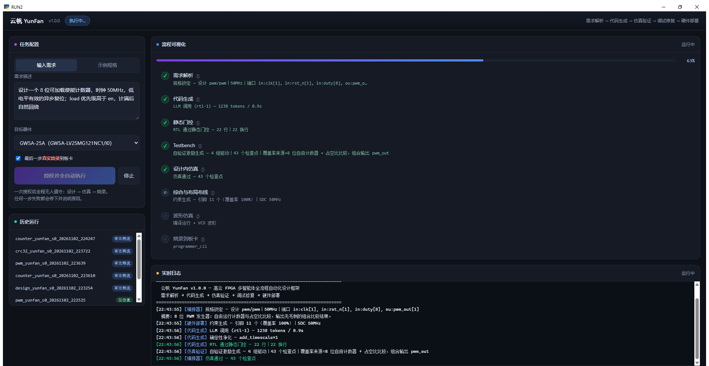
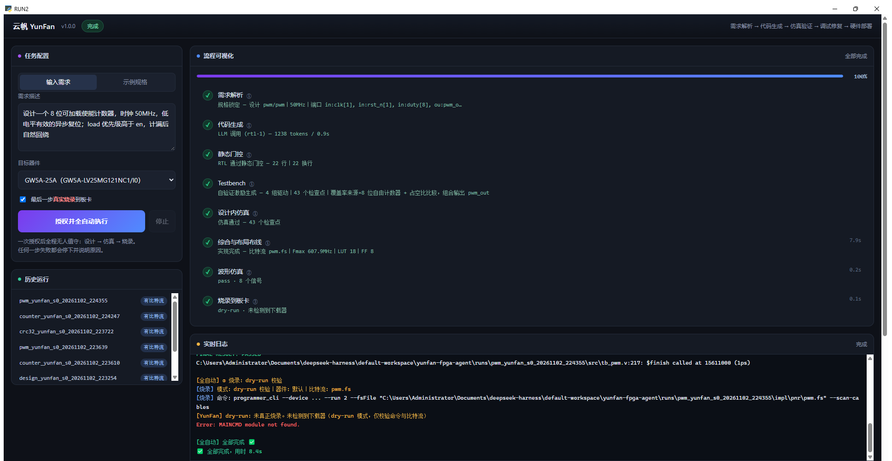
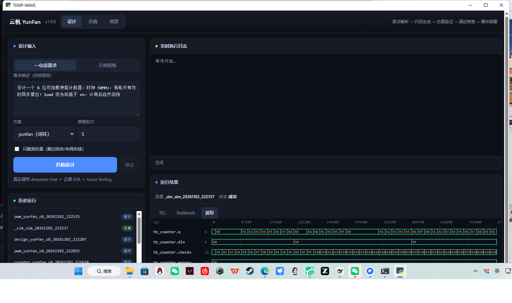
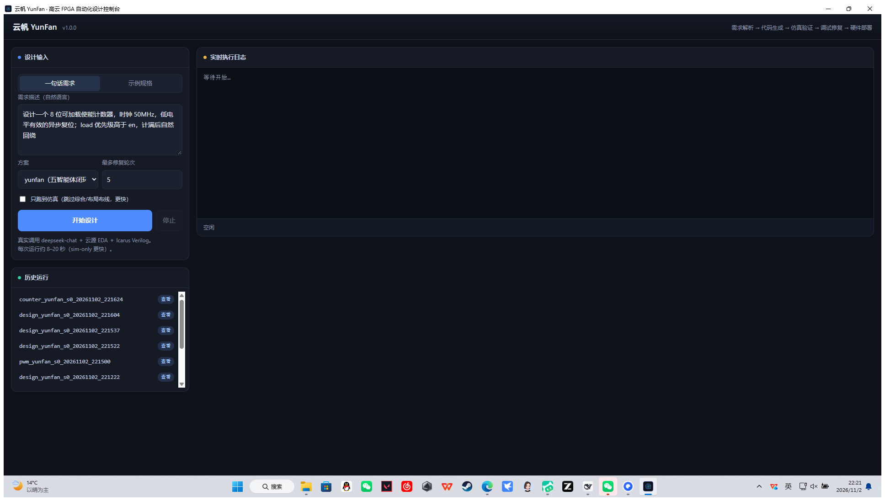

# 云帆 YunFan —— 本机部署与使用说明

> 这份文档对应**当前这台机器上已经部署好的那一份**（2026-11-02 部署）。
> 上游仓库：<https://github.com/Xxxjh1ng/yunfan-fpga-agent>

---

## 0. 一眼看懂：部署到什么程度了

| 项目 | 状态 |
| --- | --- |
| 代码位置 | `C:\Users\Administrator\Documents\deepseek-harness\default-workspace\yunfan-fpga-agent` |
| Python | 3.12.10（装在 `%LOCALAPPDATA%\Programs\Python\Python312`，仅当前用户） |
| 虚拟环境 | 项目内 `.venv`，已 `pip install -e .`，`yunfan` 命令可用 |
| 云源 EDA | ✅ `C:\Gowin\Gowin_V1.9.12_x64`（`gw_sh` + `programmer_cli` 均可调用） |
| Icarus Verilog | ✅ `C:\iverilog\bin` |
| 单元测试 | ✅ 51 / 51 通过 |
| 真实综合 + 布局布线 | ✅ 7 个基准设计全部跑通（含板卡自检 led_water / key_count） |
| 约束生成 `.cst/.sdc` | ✅ 可用 |
| 可视化控制台 | ✅ `控制台.cmd` 或桌面窗口 → http://127.0.0.1:8765 |
| 桌面软件版（独立 exe） | ✅ `dist-app\YunFan控制台.exe`，桌面快捷方式「云帆控制台」 |
| Verilog 仿真 + 波形 | ✅ 流水线第②步：iverilog 编译运行、PASS/FAIL、VCD 波形可视化 |
| 烧录到板卡 | ✅ 流水线第③步：programmer_cli，默认 dry-run，可勾选真实烧录 |
| 全自动流水线 | ✅ 一次授权 → 设计 → 仿真 → 烧录，九个节点全程可视化 |
| **大模型 API Key** | ✅ 已配置（`.env`） |

本机实测（`python scripts/selfcheck.py`，真实 gw_sh 跑出来的）：

| 设计 | 仿真 | 综合/PnR | Fmax | 逻辑资源 |
| --- | --- | --- | --- | --- |
| counter | pass | OK | 536.6 MHz | 7 |
| pwm | pass | OK | 607.9 MHz | 18 |
| crc32 | pass | OK | 384.0 MHz | 46 |
| uart_tx | pass | OK | 200.7 MHz | 54 |
| vga_timing | pass | OK | 398.4 MHz | 38 |

---

## 1. 目录结构与关键文件

```
yunfan-fpga-agent\
├── .venv\                    ← 虚拟环境（已建好，别提交）
├── .env                      ← 配置（API Key 填这里）
├── yunfan.cmd                ← 快捷入口，免激活虚拟环境
├── pyproject.toml / requirements.txt
├── yunfan\                   ← 框架源码（含 console 控制台）
│   ├── agents\               ← 五个智能体
│   ├── eda\                  ← 云源 / Icarus / 约束 / Mock 适配层
│   ├── rtl\                  ← 抽取、净化、静态检查、自动 Testbench、参考模型
│   ├── diagnostics\          ← 15 类错误分类 + 日志解析
│   ├── orchestration\        ← 规格、闭环流水线、指标
│   ├── eval\                 ← 批量评测与故障注入
│   └── data\                 ← devices.json / boards.json
├── examples\                 ← 5 个基准设计（spec.json + ref.v）
├── scripts\                  ← selfcheck / repair_bench / hw_run / hw_demo
├── tests\                    ← 51 个单元测试（不需要网络和 EDA）
├── docs\                     ← 含本文件、上板指南、论文
└── runs\ reports\            ← 运行产物与报告（自动生成）
```

如果要重建环境，只需要三条命令：

```powershell
cd C:\Users\Administrator\Documents\deepseek-harness\default-workspace\yunfan-fpga-agent
& "$env:LOCALAPPDATA\Programs\Python\Python312\python.exe" -m venv .venv
.\.venv\Scripts\python.exe -m pip install -e . pytest -i https://pypi.tuna.tsinghua.edu.cn/simple
```

---

## 2. 大模型 API Key（已配置）

框架用大模型做「需求 → 规格 → RTL」，所以必须有 Key；仿真、综合、约束这些**不需要 Key**。`YUNFAN_API_KEY` 在本机已经填好并通过 `doctor` 校验，下面步骤仅在换机器或轮换 Key 时需要重做。

1. 打开 <https://platform.deepseek.com> → API Keys → 创建，复制 `sk-` 开头的字符串；
2. 编辑项目根目录下的 `.env`：

```ini
YUNFAN_API_KEY=sk-你的真实key
YUNFAN_BASE_URL=https://api.deepseek.com
YUNFAN_MODEL=deepseek-chat
YUNFAN_PROVIDER=deepseek
```

3. 验证：

```powershell
.\yunfan.cmd doctor
```

看到 `[✓] LLM API Key` 就说明通了（四项全 ✓ 时退出码为 0）。

> 换成别的 OpenAI 兼容服务（通义、Kimi、本地 vLLM 等）只改 `YUNFAN_BASE_URL` 和 `YUNFAN_MODEL`，
> 协议是 `/chat/completions`。不填 Key 直接跑 `design` 会得到明确提示：
> `[错误] 模型初始化失败：缺少 API Key：请设置 YUNFAN_API_KEY 或 MY_API_KEY`

> ⚠️ DeepSeek Harness 界面里显示的「Tracking ID / Key：由 Harness 管理」**不能当 API Key 用**：
> 那是 Harness 内部托管的凭证，不对外导出，拿去请求 `api.deepseek.com` 只会返回 401。
> 云帆需要的是你自己的 `sk-` 开头 Key。

> 暂时没有 Key 时，可以先用 `scripts\demo_without_key.py` 跑通流水线看产物形态
> （RTL 用 `examples\*/ref.v` 代替模型输出，**不代表真实生成质量**）。

---

## 3. 日常使用

### 3.1 怎么调用

三种等价方式，任选：

```powershell
cd C:\Users\Administrator\Documents\deepseek-harness\default-workspace\yunfan-fpga-agent

.\yunfan.cmd doctor                       # 方式 A：快捷脚本（推荐，免激活）
.\.venv\Scripts\yunfan.exe doctor         # 方式 B：直接调 venv 里的命令
.\.venv\Scripts\Activate.ps1              # 方式 C：激活后随便用
yunfan doctor
```

> 若激活时报「禁止运行脚本」，先执行一次：
> `Set-ExecutionPolicy -Scope Process -Bypass`

### 3.2 命令速查

| 目的 | 命令 |
| --- | --- |
| 环境自检 | `.\yunfan.cmd doctor` |
| 用规格文件跑完整流程（推荐，可复现） | `.\yunfan.cmd design --spec examples\counter\spec.json` |
| 用一句自然语言设计 | `.\yunfan.cmd design --text "设计一个 4 位可加载使能计数器，50MHz，低有效异步复位"` |
| 只跑到仿真，不做布局布线（快） | `.\yunfan.cmd design --spec examples\counter\spec.json --mode sim-only` |
| 只生成引脚/时序约束 | `.\yunfan.cmd constraints --spec examples\vga_timing\spec.json` |
| 只生成设计规格 JSON | `.\yunfan.cmd spec --text "8 位 PWM，占空比可调" --out-spec my.json` |
| 批量评测（论文实验） | `.\yunfan.cmd eval --designs counter,pwm --variants yunfan,baseline --seeds 3` |
| 汇总已有运行记录 | `.\yunfan.cmd table --dir runs\eval` |
| 五设计全链路自检（不需 Key） | `.\.venv\Scripts\python.exe scripts\selfcheck.py` |
| 故障注入修复基准 | `.\.venv\Scripts\python.exe scripts\repair_bench.py counter crc32` |
| 无 Key 演示（参考实现代替模型，跑通全链路） | `.\.venv\Scripts\python.exe scripts\demo_without_key.py counter` |

### 3.3 常用参数

```powershell
--device GW5A-25A      # 器件：GW5A-25A / GW2A-18C / GW1NSR-4C / GW5AT-138
--board  xm_gw5a25     # 开发板：xm_gw5a25 / xm_gw2a18 / acg720
--seed 0               # 采样种子，配合多次运行看 Pass@k
--max-repair 5         # 最多修复轮次
--variant baseline     # 跑对照组「单点方案」，用于对比
--json                 # 输出结构化运行记录
--program              # 生成比特流后尝试烧录（默认 dry-run，不会动作）
--program-real         # ⚠️ 真正烧板子，确认引脚无误再用
```

### 3.4 一次运行留下什么

每次 `design` 会在 `runs\<设计>_<变体>_s<种子>_<时间戳>\` 下写完整证据链：

```
spec.json              锁定的设计规格（唯一事实源）
src\*.v .cst .sdc      最终 RTL / Testbench / 约束
yunfan_synthesize.tcl  自动生成的云源脚本（可直接在云源里重跑）
logs\*.log             每一步工具的原始输出
impl\pnr\*.fs          比特流；*.rpt.txt 资源报告；*_tr_content.html 时序
events.jsonl           逐事件轨迹（谁、第几秒、做了什么、花了多少 token）
trace.json             同上，程序可读
summary.md             ← 人看这个就够了
<run_id>.json          结构化指标、诊断分布、修复方法序列
```

想快速看结果：`Get-Content runs\<目录>\summary.md`。

---

## 4. 可视化控制台（桌面窗口 / 浏览器）

不想敲命令时用这个。界面上只有一屏：**左边配置，右边看流程**。

- 桌面窗口：双击 `dist-app\YunFan控制台.exe`（或桌面的「云帆控制台」）；
- 浏览器：双击 `控制台.cmd` → <http://127.0.0.1:8765>；
- 手动：`.\venv\Scripts\python.exe -m yunfan.console --port 8765`。

### 4.1 界面布局

| 区域 | 内容 |
| --- | --- |
| 左上 · 任务配置 | 输入需求 / 示例规格、目标器件、是否真实烧录、授权与停止 |
| 右上 · 流程可视化 | 进度条 + 9 个流程节点，实时显示「在做什么 / 结果 / 耗时」 |
| 右下 · 实时日志 | 工具原始输出，按智能体着色 |
| 底部 · 运行结果 | 运行摘要 / RTL / Testbench / 波形 四个页签 |

右上角「⚙ 设置」可直接填写 API Key、BASE_URL、MODEL 与工具路径（写入根目录 `.env`），
旁边的「测试环境」会跑一次 `yunfan doctor` 并回显检查结果；未配置 Key 时页面顶部有常驻提醒条。

运行中（5 个节点已完成，`综合与布局布线` 正在跑）：



### 4.2 九个流程节点

| 节点 | 阶段 | 具体在做什么 |
| --- | --- | --- |
| 需求解析 | ① | 自然语言 → 机器可读规格（端口表 / 时钟 / 复位） |
| 代码生成 | ① | LLM 生成 Verilog，附 token 与耗时 |
| 静态门控 | ① | 端口契约逐字比对 + Lint，毫秒级拦截 |
| Testbench | ① | 参考模型生成激励与逐拍检查点 |
| 设计内仿真 | ① | iverilog 编译运行并判定通过 / 失败 |
| 调试修复 | ① | 失败时才出现，显示最小编辑补丁过程 |
| 综合与布局布线 | ① | 云源 `gw_sh` → 比特流，附 Fmax / LUT / FF |
| 波形仿真 | ② | 独立再跑一次，产出 VCD 并解析波形 |
| 烧录到板卡 | ③ | `programmer_cli --run 2`（或 dry-run 校验） |

进度条按 8 个必过节点计算，「调试修复」只在真正触发时插入并计时。

### 4.3 一次授权，无人值守

点「授权并全自动执行」→ **只弹一次确认框**（讲清 ①②③ 要做的事，以及是否真实烧录）→
确认后全程不再询问。

**失败即停**，并明确告诉你是哪一步：

- ① 设计失败 → 不进入仿真；
- ② 仿真失败 → **绝不烧录**（不把未验证的设计写进板子）；
- ③ 烧录失败 → 提示下载器未连接 / 驱动未装。

完成后：



每个节点都留下结果与耗时（如 `实现完成 — 比特流 pwm.fs｜Fmax 607.9MHz｜LUT 18｜FF 8`、
`pass · 8 个信号`、`dry-run · 未检测到下载器`），阶段信息同时写进运行目录的 `auto.json`。

### 4.4 波形



结果区「波形」页签用 canvas 画：1 位信号画高低电平，总线画色块并在块内标十六进制值，
顶部按 `$timescale` 换算时间刻度，左侧标注信号名与位宽。
Testbench 缺 `$dumpfile/$dumpvars` 时会自动补，所以一定有波形。

### 4.5 历史与深链接

- 「历史运行」列出带比特流的运行，点开回看摘要 / RTL / 波形（全自动跑过的还带阶段耗时）；
- 深链接：`#run=<运行目录>`、`#run=<运行目录>&wave`；
- `#autorun=counter` 可直接跑一次示例（**固定 dry-run**，避免误烧板卡）；
- 实现文件：`yunfan\console\server.py`（HTTP + SSE + 进程编排）、`yunfan\console\index.html`（单页前端）、
  `yunfan\console\vcd.py`（VCD 解析）、`yunfan\console\eda_bridge.py`（在 .venv 里执行仿真/烧录）。

> 服务只监听 `127.0.0.1`，不对局域网开放。换端口：`python -m yunfan.console --port 9000`。
>
> 小提示：**示例规格（counter/pwm/…）最稳**，Testbench 由周期精确参考模型生成；
> 「输入需求」走的是模型自写 Testbench，偶发失败很正常（见第 8 节建议）。

### 4.6 实测（本机，示例规格，烧录为 dry-run）

| 设计 | ① 设计 | ② 仿真 | ③ 烧录 | 总计 |
| --- | --- | --- | --- | --- |
| counter | 8.4 s | 0.1 s | 0.1 s | **8.8 s** |
| pwm | 7.9 s | 0.2 s | 0.1 s | **8.4 s** |
| crc32 | 10.6 s | 0.2 s | 0.1 s | **10.9 s** |

> 安全设计：接口必须带 `authorized: true`，否则 400 拒绝；真实烧录还需 `real: true`，
> 界面上再叠一层 `confirm`。想先演练就取消「真实烧录」勾选。

---

### 4.7 真机验证记录（本机 ACG720）

| 项目 | 结果 |
| --- | --- |
| 板卡 / 下载器 | 芯路恒 ACG720（GW5AT-138B）｜Gowin USB Cable(FT2CH) |
| 引脚表核对 | 与 `高云 ACG720-138&60K通用管脚分配表.xlsx` 逐项一致（clk Y18 / led0-8 / sw0-7 / 按键 / UART） |
| LED 极性 | 实测**高电平点亮**（led_water 流水灯正常） |
| led_water（自建示例） | 全自动 41.2 s：模型生成 RTL → 45 个检查点通过 → Fmax 191.0 MHz / LUT 55 / FF 32 → 33.08 MB → **真实烧录成功** ✅ |
| key_count（自建示例） | 全自动 40.3 s：45 个检查点通过 → Fmax 165.7 MHz / LUT 66 / FF 27 → **真实烧录成功** ✅ |
| vga_bars（参考实现） | 72 项颜色检查通过 → Fmax 195.4 MHz / LUT 48 / FF 23 → 29 引脚 100% 映射 → 真实烧录成功 ✅ |
| vga_bars（**模型生成**） | 全自动 52.0 s：模型按 implementation_rules 生成 98 行 RTL → 24 个检查点通过 → Fmax 213.3 MHz / LUT 47 / FF 23 → **真实烧录成功** ✅ |
| hw_run led_water | 综合 28–30 s，比特流 33.08 MB，Fmax 187.6 MHz，SRAM 烧录成功，8 颗 LED 依次点亮 ✅ |
| pwm_sw | 比特流 33.08 MB，Fmax 589.5 MHz，烧录成功（拨 SW0–SW7 调 LED0 亮度） |
| 烧录通道 | 命令行与控制台（exe）两条路径均实测可写板卡 |

结论已回写到 `yunfan/data/boards.json` 的 acg720 `notes` 字段，便于以后追溯。

---
## 5. 桌面软件版（exe）

双击 **`dist-app\YunFan控制台.exe`**（或桌面上的「云帆控制台」快捷方式）即可，
打开的是一个**原生窗口**：没有地址栏、没有标签页，任务栏独立图标，关掉窗口程序就退出。



- 技术栈：`pywebview` + Edge WebView2 承载同一套界面，体积 11.3 MB，启动约 2–3 秒；
- 三种入口任选：**exe（原生窗口）** / `控制台.cmd`（浏览器标签页）/ 纯命令行 `yunfan`；
- exe 只是外壳：真正跑设计仍用项目里的 `.venv`，所以 **exe 必须留在项目目录内**
  （放在根目录或 `dist-app\` 都能自动找到根目录）；
- 界面 `yunfan\console\index.html` 是运行时读取的，改样式/文案**不用重新打包**；
- 关窗口时会一并结束还在跑的 `gw_sh` / `iverilog` 子进程，不会留后台残留。

重新打包（改过 `app.py` / 换了图标之后）：

```powershell
.\.venv\Scripts\pyinstaller.exe --noconfirm --clean --onefile --noconsole `
  --name "YunFan控制台" --icon "$PWD\yunfan\console\icon.ico" `
  --distpath "$PWD\dist-app" --workpath "$PWD\build-app" --specpath "$PWD\build-app" `
  "$PWD\app.py"
```

调试用：`.\dist-app\YunFan控制台.exe --headless --port 8780`（只起服务不开窗口）、
`python app.py --browser`（退回浏览器）。

---

## 6. 本次部署对上游代码做的两处修改

上游代码在**这台机器的环境**下有两处会直接失败，已修好；两处都是上游问题，不是本机配置问题。

### 6.1 `yunfan/eda/gowin.py`：器件名消歧（关键）

- **现象**：所有设计综合阶段报
  `there are more than one device named GW5A-LV25MG121NC1/I0, please specify its name as well`，
  5 个设计全部 PnR 失败。
- **原因**：同一个 part number 在云源器件库里对应多个器件名
  （`GW5A-25A` 与 `GW5A-25B`、`GW5AT-138B` 与 `GW5AT-138C`），
  `set_device` 必须带 `-name` 或 `-device_version` 才能确定唯一目标；
  上游只处理了「单字母 version」，而 GW5A 的版本是 `C1`，于是两边都没拼上。
- **修法**：新增 `_device_names()` 读云源自带的 `IDE\share\device\device_info.csv`，
  按「配置名是否属于该 part → 库中是否唯一 → 单字母版本 → 库中首个器件名」的顺序决定参数。
  实测四种器件全部解析正确（GW5A-25A / GW2A-18C / GW1NSR-4C / GW5AT-138）。
- **不修的后果**：`--mode sim-only` 之前一切正常，一旦进入综合就 100% 失败。

### 6.2 `pyproject.toml`：去掉 UTF-8 BOM

- **现象**：`pip install -e .` 报 `tomllib.TOMLDecodeError: Invalid statement (at line 1, column 1)`。
- **原因**：文件开头有 UTF-8 BOM（`EF BB BF`），而 `tomllib` 不接受 BOM。
- **修法**：另存为无 BOM 的 UTF-8（内容未改）。全仓还有 13 个 `.py` 文件带 BOM，
  Python 能正常解析，故未动，避免无关 diff。

> 想还原上游原样：重新下载仓库 zip 覆盖这两个文件即可（`yunfan/eda/gowin.py`、`pyproject.toml`）；
> 但还原后综合会重新失败。

---

### 6.3 烧录：打包 exe 下会自动改用 WMI 起进程（已修复）

**现象**：在打包后的控制台里点「真实烧录」，programmer_cli 返回
`Error: MAINCMD module not found.`；同一份比特流在命令行里调用则正常。

**原因**：云源的 programmer_cli 自身也是 PyInstaller 程序，作为「打包 exe 的子进程」
启动时会误判运行环境而跳过自身模块解包。

**处理**（`yunfan/eda/gowin.py`）：

1. 命令的 stdout **必须重定向到文件**（用管道捕获直接触发该错误）；
2. 直接启动失败（日志出现 MAINCMD）时，自动改用 **WMI 创建进程**
   （`Win32_Process.Create`）重跑一次——该进程由 WmiPrvSE 派生，不在当前进程树里，
   实测可正常烧录（`verdict=programmed`，`cable_detected=True`）。

因此控制台与命令行的烧录行为现已一致；若 WMI 被系统策略禁用，仍可用：

```powershell
.\.venv\Scripts\python.exe scripts\hw_run.py run led_water
.\.venv\Scripts\python.exe -m yunfan design --spec <spec> --program --program-real
```
### 6.4 新增 implementation_rules：把「实现约定」喂给模型

自建示例时发现：同一份行为规格，模型可能用「派生时钟」等不同实现，导致与参考模型的时序约定不一致而验证失败。

处理：`DesignSpec` 新增 `implementation_rules`（字符串数组），流水线把它作为 `extra_rules`
传给 RTL 智能体；规格里写清楚「单时钟域 / 相位推进 / 同步信号打拍」等结构约束后，
VGA 彩条一次通过（98 行 RTL、24 个检查点、Fmax 213.3 MHz）。该字段对所有设计通用。
## 7. 常见问题

**Q：终端里中文变成 `锟斤拷` / `����`？**
控制台编码问题，先 `chcp 65001` 再执行命令（程序内部已对 stdout 做了 utf-8 兜底）。

**Q：`doctor` 里 `[×] LLM API Key`？**
第 2 节的 Key 没填或填错（注意 `.env` 不要有多余空格/引号；已存在的同名环境变量优先级更高）。

**Q：报 `device ... has not version` 或 `can't find device`？**
说明 `yunfan/data/devices.json` 里该器件的 `name` / `device_version` 与你的云源版本器件库不一致。
用云源的 `IDE\share\device\device_info.csv` 对照改这两个字段即可，代码无需改。

**Q：教育版云源报器件不支持？**
教育版只覆盖 GW5A-25A / GW2A-18C / GW1NSR-4C 等少数器件。
本机装的是 **V1.9.12 完整版**，GW5AT-138 可用。

**Q：怎么真正烧到板子？**
默认 `--program` 也是 dry-run。确认引脚后再 `--program-real`。
完整步骤、ACG720 引脚表和踩坑记录见 [`docs\上板指南.md`](上板指南.md)，一键复跑：
`python scripts\hw_demo.py detect --device GW5AT-138` → `python scripts\hw_run.py run led_water`。

**Q：怎么换自己的板子？**
只改 `yunfan\data\boards.json`（引脚表）和 `devices.json`（容量），不用改代码。

**Q：以后怎么更新到上游最新版？**
本机没有装 git。可以重新下载 zip 覆盖源码目录，但**记得重新应用 6.1 的补丁**
（或先装 git：`winget install --id Git.Git -e`，然后 `git pull` + 自己维护补丁）。

---

## 8. 典型工作流建议

1. 先用 `examples\` 里的 5 个规格跑通（`--mode sim-only` 快，`full` 完整）；
2. 看 `runs\<run>\summary.md` 和 `impl\pnr\*_tr_content.html` 确认时序；
3. 换成自己的需求：`design --text "..."` 生成 `spec.json`，人工核一眼端口表；
4. 用 `--spec 你的spec.json` 复跑，保证可复现；
5. 引脚/板卡对上后再 `--program-real` 上板。
